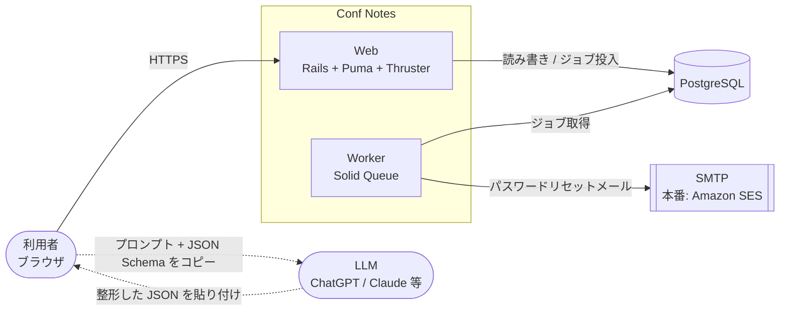
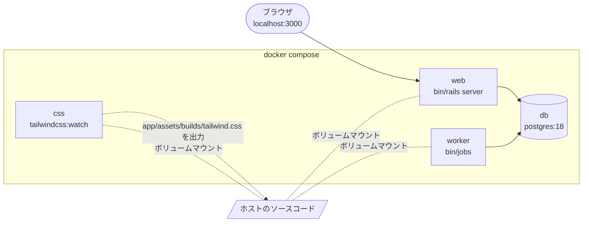
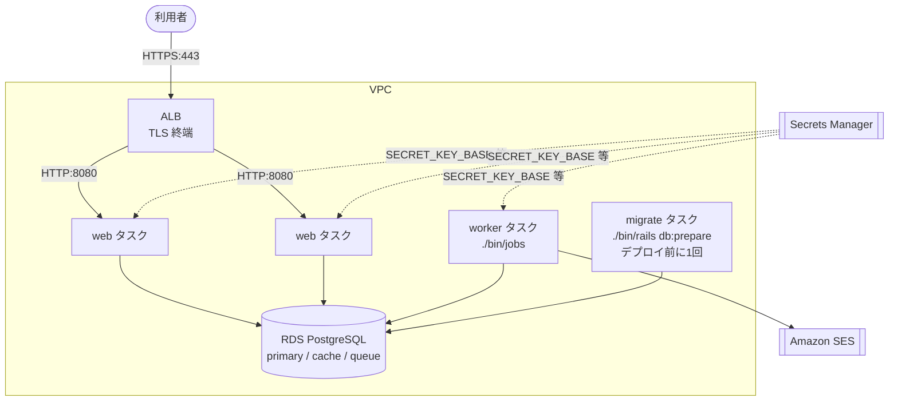
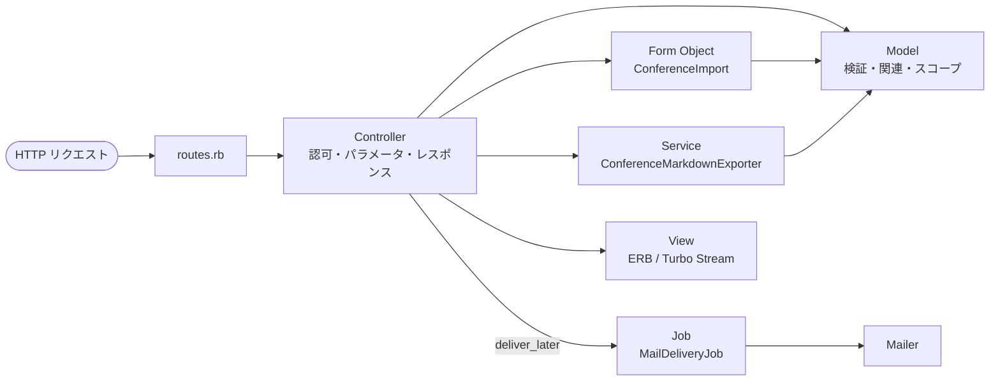
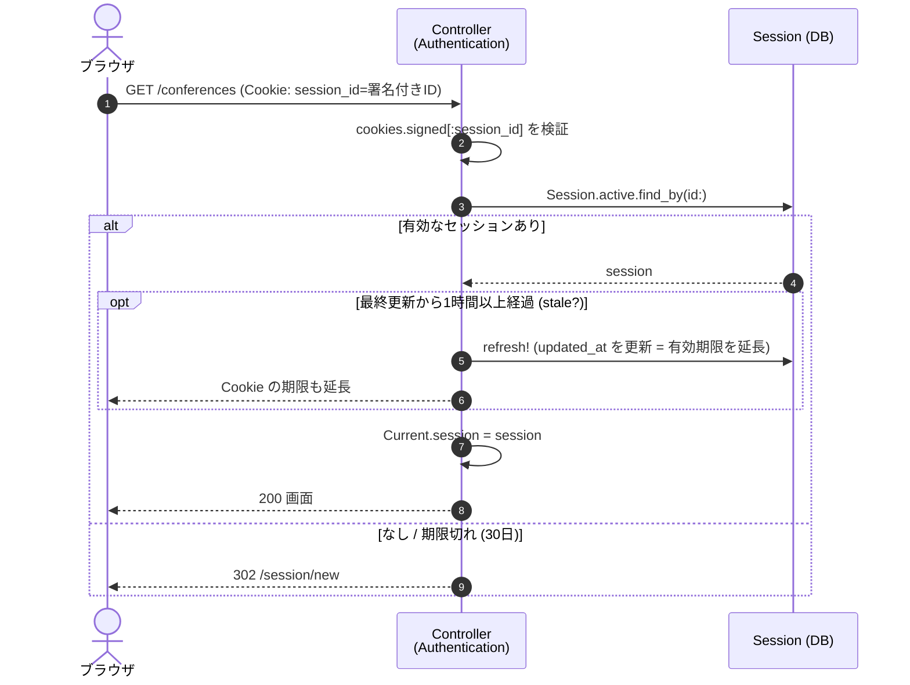
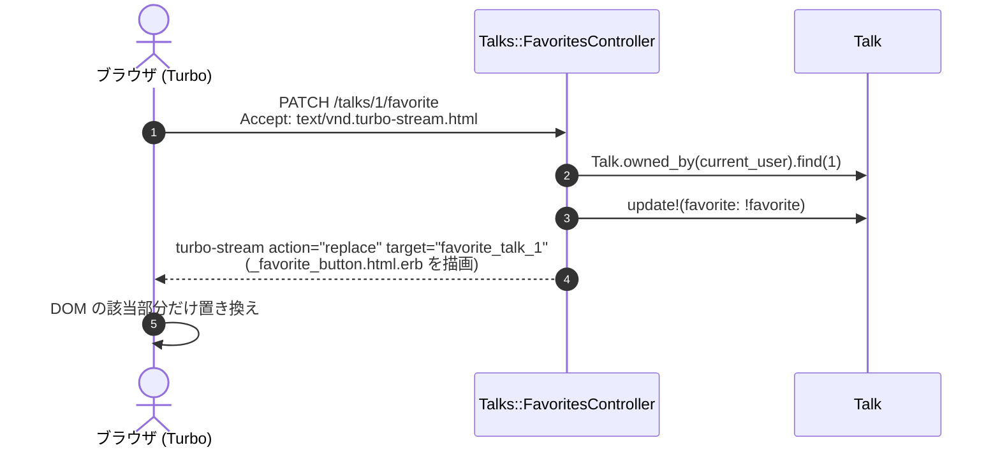
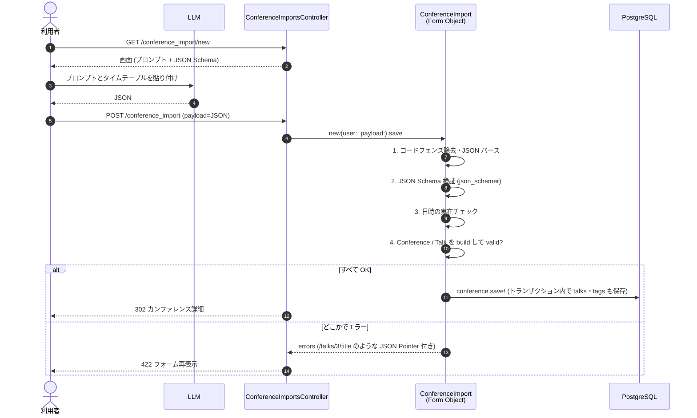
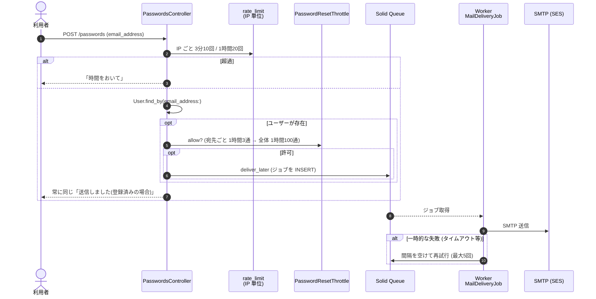

# アーキテクチャ

Conf Notes の全体構成と、主要な処理の流れをまとめる。データ構造は [domain-model.md](domain-model.md)、
なぜその構成にしたかは [adr/](adr/) を参照。

## 1. システム全体像



- **Web** は画面とフォームを返す普通の Rails アプリ (SPA ではない)。画面の部分更新は Turbo
- **Worker** は時間のかかる処理 (メール送信) と定期処理 (期限切れセッションの削除) を担当する
- ジョブキュー・キャッシュも PostgreSQL に置く (Solid Queue / Solid Cache)。**Redis は使わない** ([ADR-0002](adr/0002-postgresql-and-solid-stack.md))
- LLM はアプリから直接呼ばない。ユーザーがコピー&ペーストで仲介する ([ADR-0005](adr/0005-single-json-schema-for-import.md))

## 2. 実行環境

### 開発 (`compose.yaml`)



- ホストに Ruby は不要。すべてコンテナ内で動く ([ADR-0001](adr/0001-docker-only-development.md))
- ソースはマウントしているので、編集すれば web が自動で再読み込みする
- 送信メールは http://localhost:3000/letter_opener で確認する (実際には送られない)

### 本番 (AWS ECS 想定)



| コンテナ | command | 役割 |
| --- | --- | --- |
| web | (既定) `./bin/thrust ./bin/rails server` | Thruster が :8080 で受け、Puma (:3000) に渡す。静的ファイル配信と圧縮も Thruster |
| worker | `./bin/jobs` | Solid Queue。メール送信と定期ジョブ |
| migrate | `./bin/rails db:prepare` | デプロイ前の単発タスク。web/worker は起動時にマイグレーションしない |

- **同じイメージを command 違いで使い回す** (12-factor の「ビルド・リリース・実行の分離」)
- 設定はすべて環境変数。一覧は [README](../README.md#本番イメージ-ecs-想定)、インフラ側の前提は [deployment.md](deployment.md)
- ポート 8080・マイグレーションを分ける理由は [ADR-0006](adr/0006-production-container-design.md)

## 3. ディレクトリ構成と責務

```
app/
├── controllers/          リクエストを受けてモデルを呼び、レスポンスを返す (ロジックは書かない)
│   ├── concerns/authentication.rb   ログイン状態の管理 (全コントローラに include)
│   ├── conferences/      カンファレンス配下のサブリソース (exports)
│   ├── conference_imports/  インポート配下のサブリソース (schemas)
│   └── talks/            セッション配下のサブリソース (favorites)
├── models/               データとビジネスルール
│   ├── (ActiveRecord)    user, session, conference, talk, tag, tagging
│   └── (ActiveModel)     conference_import (フォームオブジェクト), password_reset_throttle, current
├── services/             複数モデルにまたがる変換 (conference_markdown_exporter)
├── jobs/                 非同期処理 (mail_delivery_job, expired_sessions_cleanup_job)
├── mailers/              メール (passwords_mailer)
├── schemas/              JSON Schema (インポート形式の唯一の定義)
├── views/                ERB テンプレート (HTML / Turbo Stream / メール)
├── javascript/controllers/  Stimulus コントローラ (char_count, clipboard)
└── assets/tailwind/      Tailwind CSS (独自ユーティリティは @utility)
config/
├── routes.rb             URL → コントローラの対応表
├── locales/ja.yml        画面の文言すべて
├── environments/         環境ごとの設定 (production.rb が本番)
└── recurring.yml         定期ジョブの設定
db/
├── migrate/              マイグレーション (スキーマの変更履歴)
├── schema.rb             現在のスキーマ (自動生成。手で書かない)
└── queue_schema.rb, cache_schema.rb   Solid Queue / Solid Cache 用
spec/                     テスト (models / requests / system / ...)
```

### ロジックの置き場所



| 置き場所 | 判断基準 | 例 |
| --- | --- | --- |
| Model | そのモデルだけで完結するルール | `Talk#tag_list=`, `Conference#used_tags` |
| Form Object | DB のテーブルに対応しない入力 | `ConferenceImport` (JSON → 複数レコード) |
| Service | 複数モデルを読んで何かを作る | `ConferenceMarkdownExporter` |
| Job | 時間がかかる / 外部と通信する / 定期実行 | `MailDeliveryJob`, `ExpiredSessionsCleanupJob` |
| Controller | 上記を呼ぶだけ。REST の7アクションのみ | REST 以外の操作はサブリソースに切り出す (`Talks::FavoritesController#update`) |

## 4. ルーティング

| メソッド | パス | コントローラ#アクション | 用途 |
| --- | --- | --- | --- |
| GET | `/` | `conferences#index` | 一覧 (トップ) |
| GET/POST | `/session/new`, `/session` | `sessions#new/create` | ログイン |
| DELETE | `/session` | `sessions#destroy` | ログアウト |
| GET/POST | `/registration/new`, `/registration` | `registrations#new/create` | 新規登録 |
| GET/POST | `/passwords/new`, `/passwords` | `passwords#new/create` | リセットメール要求 |
| GET/PATCH | `/passwords/:token/edit`, `/passwords/:token` | `passwords#edit/update` | 新パスワード設定 |
| (7種) | `/conferences[/:id]` | `conferences#*` | カンファレンス CRUD |
| GET | `/conferences/:id/export` | `conferences/exports#show` | Markdown ダウンロード |
| GET/POST | `/conferences/:id/talks/new`, `/conferences/:id/talks` | `talks#new/create` | セッション作成 |
| GET/PATCH/DELETE | `/talks/:id[/edit]` | `talks#show/edit/update/destroy` | セッション (shallow ルート) |
| PATCH | `/talks/:id/favorite` | `talks/favorites#update` | お気に入り切替 (Turbo Stream) |
| GET/POST | `/conference_import/new`, `/conference_import` | `conference_imports#new/create` | JSON インポート |
| GET | `/conference_import/schema(.json)` | `conference_imports/schemas#show` | JSON Schema |
| GET | `/up` | `rails/health#show` | ALB のヘルスチェック |

実際の一覧は `docker compose exec web bin/rails routes` で確認できる。

## 5. 主要な処理の流れ

### 5.1 リクエストの共通処理 (認証)

すべてのコントローラは `Authentication` concern を通る。ログインしていなければログイン画面へ。



- セッションは DB に保存し、Cookie には署名付きの ID だけを入れる
- 有効期限は「最後のアクセスから30日」(スライディング方式)。毎リクエストで UPDATE しないよう1時間ごとにまとめて延長
- 期限切れのレコードは `ExpiredSessionsCleanupJob` が毎日4時に削除 (`config/recurring.yml`)

### 5.2 お気に入りの切り替え (Turbo Stream)

ページ全体を再読み込みせず、ボタンだけを差し替える。JavaScript は書いていない。



### 5.3 JSON インポート



- 検証を段階に分けるのは、JSON Schema で表せない制約 (終了日 ≥ 開始日など) をモデル側で見るため
- 1件でも失敗したら何も保存しない (all or nothing)

### 5.4 パスワードリセット (非同期メール + 送信数制限)



- 応答を常に同じにするのは、**アドレスが登録済みかどうかを推測させない**ため
- 送信数は「リクエスト数」ではなく「実際に送った数」で数える ([ADR-0008](adr/0008-rate-limiting-with-rails-cache.md))

## 6. 横断的な関心事

| 関心事 | 実装 |
| --- | --- |
| 認証 | Rails 8 の authentication ジェネレータ (`has_secure_password` + DB セッション) |
| 認可 | すべて `current_user` 起点で検索 (`current_user.conferences.find`, `Talk.owned_by`)。他人のデータは 404 |
| 入力検証 | モデルの `validates` + DB 制約 (NOT NULL / 外部キー / ユニーク / CHECK) の二重 |
| レート制限 | `rate_limit` (Rails 8 標準) と `PasswordResetThrottle`。カウンタは `Rails.cache` |
| 国際化 | 文言はすべて `config/locales/ja.yml`。未定義の訳があると開発・テストで例外 |
| N+1 検出 | Bullet (テストでは例外にする) |
| セキュリティヘッダ | CSP (外部オリジン不許可)、HSTS、Host ヘッダ許可リスト。詳細は [deployment.md](deployment.md) |
| ログ | 本番は標準出力 (CloudWatch Logs へ)。リクエスト ID 付き |
