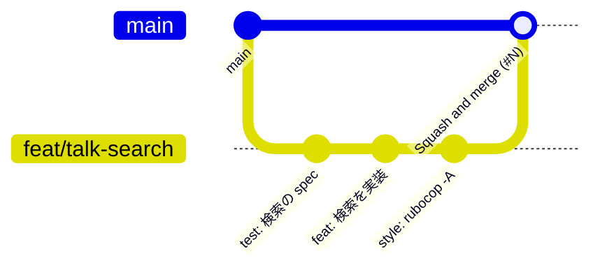
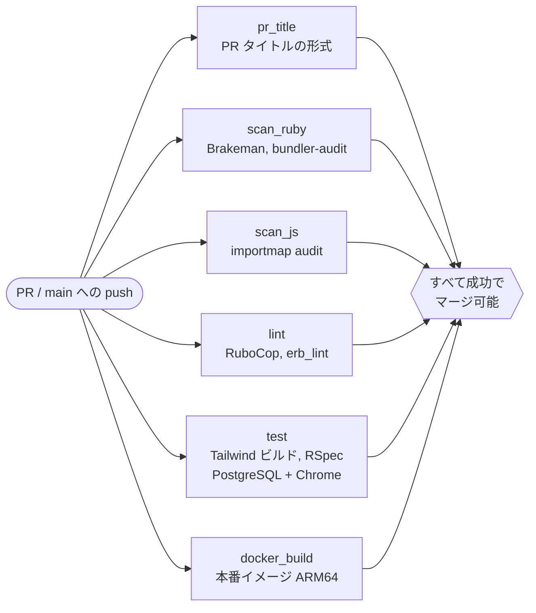
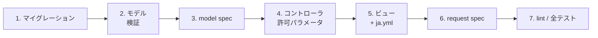
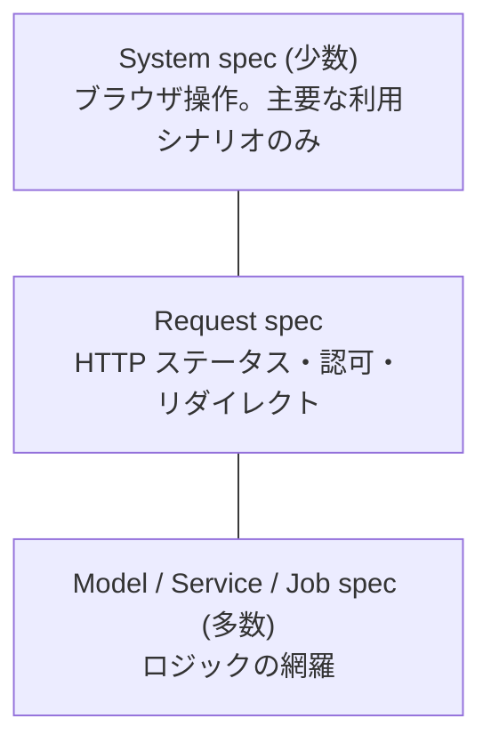

# 開発ガイド

日々の開発の進め方。セットアップは [README](../README.md)、規約は [CONTRIBUTING.md](../CONTRIBUTING.md) を参照。

## 1. 開発の流れ



1. `main` からブランチを切る (`feat/xxx`, `fix/xxx` など)
2. 実装 + spec。コミット時に Lefthook が RuboCop / erb_lint / メッセージ形式を検査
3. push → `gh pr create --fill`。PR タイトルは Conventional Commits 形式
4. CI がすべて緑になったら Squash and merge (PR タイトルが `main` のコミットメッセージになる)

`main` はブランチ保護されており、管理者でも直接 push できない。

### CI で走るもの



## 2. よく使うコマンド

`docker compose up` している前提。止まっているときは `exec` を `run --rm` に読み替える。

| やりたいこと | コマンド |
| --- | --- |
| Rails コンソール | `docker compose exec web bin/rails console` |
| DB コンソール (psql) | `docker compose exec web bin/rails dbconsole` |
| ルート一覧 | `docker compose exec web bin/rails routes` (`-g talk` で絞り込み) |
| マイグレーション作成 | `docker compose exec web bin/rails g migration AddMemoToConferences memo:text` |
| マイグレーション実行 | `docker compose exec web bin/rails db:migrate` (モデルの注釈も自動更新) |
| 1つ戻す | `docker compose exec web bin/rails db:rollback` |
| サンプルデータ | `docker compose exec web bin/rails db:seed` (demo@example.com / password123) |
| テスト全部 | `docker compose run --rm -e RAILS_ENV=test web bundle exec rspec` |
| テスト1ファイル / 1行 | `... bundle exec rspec spec/models/talk_spec.rb:42` |
| Lint 自動修正 | `docker compose exec web bin/rubocop -A` / `bundle exec erb_lint --lint-all -a` |
| gem 追加 | Gemfile を編集 → `docker compose exec web bundle install` → `docker compose restart web worker` |
| ログを見る | `docker compose logs -f web` |
| 全部作り直す | `docker compose down -v && docker compose up --build` (**DB の中身も消える**) |

## 3. 機能追加の手順 (例: カンファレンスに「メモ」欄を足す)

Rails ではこの順番で進めると迷いにくい。外側 (画面) からではなく内側 (データ) から作る。



1. **マイグレーション**
   ```sh
   docker compose exec web bin/rails g migration AddMemoToConferences memo:text
   docker compose exec web bin/rails db:migrate
   ```
   `db/schema.rb` とモデル先頭の注釈コメントが更新される。両方コミットする
2. **モデル**: `app/models/conference.rb` に `validates :memo, length: { maximum: 2000 }`
3. **model spec**: `spec/models/conference_spec.rb` に `it { is_expected.to validate_length_of(:memo).is_at_most(2000) }`
4. **コントローラ**: `ConferencesController#conference_params` の `params.expect` に `:memo` を追加
   (ここを忘れると、フォームから送っても黙って無視される)
5. **ビュー**: `app/views/conferences/_form.html.erb` に入力欄、`show.html.erb` に表示。
   ラベルは `config/locales/ja.yml` の `activerecord.attributes.conference.memo`
6. **request spec**: 送った値が保存されることを `spec/requests/conferences_spec.rb` で確認
7. `bin/rubocop -A` → `erb_lint -a` → `rspec` → コミット

## 4. デバッグ

### コードを止めて中を見る (debug gem)

止めたい場所に `debugger` と書く。

```ruby
def show
  debugger
  @talks = ...
end
```

web コンテナは `tty` / `stdin_open` を有効にしてあるので、別のターミナルでアタッチして操作する。

```sh
docker compose attach web     # 止まった行でプロンプトが出る
```

| コマンド | 意味 |
| --- | --- |
| `n` | 次の行へ |
| `s` | メソッドの中に入る |
| `c` | 続行 |
| `info` | ローカル変数の一覧 |
| `@talks.to_a` など | 任意の Ruby を評価 |

抜けるときは `Ctrl-P Ctrl-Q` (Ctrl-C だとサーバごと止まる)。テスト中は `rspec` を実行したターミナルでそのまま止まる。

### コンソールで試す

```ruby
user = User.first
user.conferences.recent_first.to_a
Talk.owned_by(user).tagged_with("ruby").to_sql   # 発行される SQL を確認
Conference.first.talks.count                       # SQL が実行される
reload!                                            # コードを変更したら読み込み直す
```

### よくある症状

| 症状 | 原因と対処 |
| --- | --- |
| CSS が当たらない | `docker compose logs css` を確認。Tailwind v4 で `@layer components` のクラスを `@apply` するとビルドが落ちる → `@utility` を使う |
| `Bullet::Notification::UnoptimizedQueryError` | N+1 クエリ。`includes(:tags)` を付けるか `counter_cache` を使う |
| `I18n::MissingTranslationData` | ja.yml にキーが無い。ビューの `t(".xxx")` は `<コントローラ>.<アクション>.xxx` を探す |
| `ActiveRecord::PendingMigrationError` | `bin/rails db:migrate` を実行 |
| フォームから送った値が保存されない | コントローラの `params.expect` に追加し忘れ |
| 他のタブでは動くのに Turbo の画面遷移後に JS が動かない | `DOMContentLoaded` ではなく Stimulus の `connect()` で処理を書く |
| gem を追加したのに `cannot load such file` | `bundle install` 後に `docker compose restart web worker` |
| `StrongMigrations::UnsafeMigration` | 安全でない書き方。エラーメッセージに書かれた安全な手順に分割する |

## 5. テスト方針



| 種類 | 場所 | 書くもの |
| --- | --- | --- |
| model | `spec/models` | 検証、スコープ、メソッドの振る舞い。境界値 (100文字 / 101文字) |
| request | `spec/requests` | ログイン必須か、他人のデータで 404 になるか、成功時/失敗時のステータス |
| system | `spec/system` | 画面を通したシナリオ。JS が必要なものだけ `:js` を付ける (遅いので最小限) |
| job / service | `spec/jobs`, `spec/services` | 入力と出力 |

- データは FactoryBot (`create(:talk, :attended)`)。fixtures は使わない
- 時刻に依存するテストは `travel_to` / `travel` で固定する
- テスト中は Bullet が N+1 を例外にし、未定義の訳文も例外にする。警告を見逃さない仕組み
- カバレッジは `coverage/index.html` (SimpleCov)。数値より「境界と異常系を書いたか」を重視する

## 6. 依存関係の更新

- Dependabot が月1回 (第1月曜) まとめて PR を出す。脆弱性の修正 PR はその都度
- CI が通れば基本はマージしてよい。メジャーバージョンアップは CHANGELOG を確認する
- Ruby 本体の更新は Dependabot の対象外。手順は [CLAUDE.md](../CLAUDE.md#ruby-のバージョンを上げるとき)
