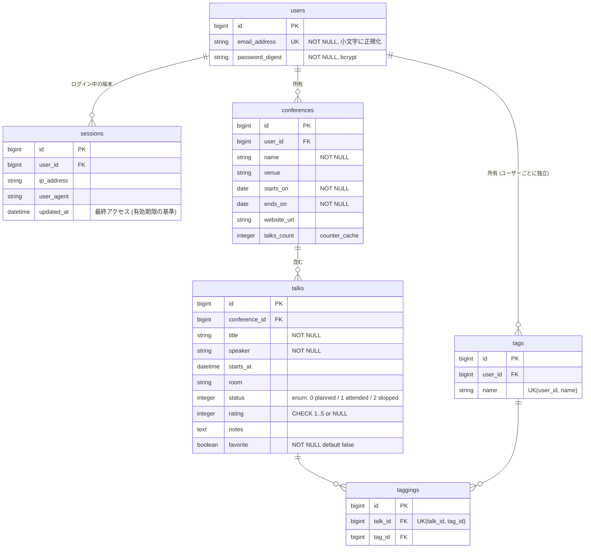
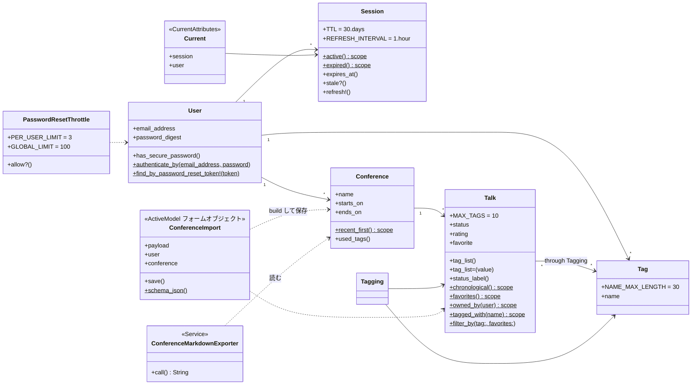
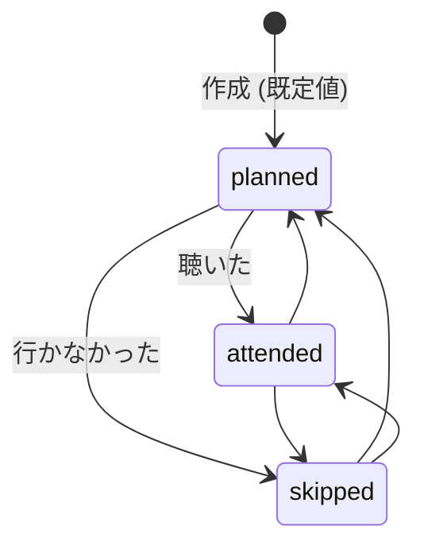

# ドメインモデル

データの構造と、モデルごとのルールをまとめる。実際のスキーマは `db/schema.rb`、
各モデルの先頭コメント (annotaterb が自動生成) も参照。

## 1. ER 図



- すべての外部キーに DB の外部キー制約を張っている
- `tags` はユーザーごと。A さんの `ruby` タグと B さんの `ruby` タグは別レコード
- `talks` と `tags` は多対多で、中間テーブルが `taggings` (`has_many :through`)
- ほかに Solid Queue / Solid Cache 用のテーブルが別 DB にある (`db/queue_schema.rb`, `db/cache_schema.rb`)

## 2. クラス図



`$` はクラスメソッド (またはスコープ)。

## 3. Talk のステータス



遷移の制約はなく、編集画面のセレクトボックスで自由に変えられる。enum は整数で保存 (`0/1/2`)。
画面に出す日本語は `Talk#status_label` → `config/locales/ja.yml` の `activerecord.enums.talk.status`。

## 4. ルールと、それをどこで守っているか

アプリ (Rails のバリデーション) と DB (制約) の両方で守るのが基本方針。
アプリ側だけだと、並行リクエストやコンソールからの直接操作ですり抜けるため。

| ルール | アプリ | DB |
| --- | --- | --- |
| メールアドレスは一意 | `validates :email_address, uniqueness: true` | ユニークインデックス |
| カンファレンス名は必須・100文字以内 | `validates :name, presence: true, length:` | NOT NULL |
| 終了日 ≥ 開始日 | `Conference#ends_on_not_before_starts_on` | - |
| URL は http(s) でホストあり | `Conference#website_url_must_be_http` | - |
| 評価は 1〜5 か未設定 | `validates :rating, numericality:` | CHECK 制約 `talks_rating_range` |
| ステータスは3種のどれか | `enum ... validate: true` | NOT NULL |
| タグ名はユーザー内で一意・30文字以内 | `Tag` の `validates` | ユニークインデックス `(user_id, name)` |
| 1セッションのタグは10個まで | `Talk#tag_names_must_be_valid` | - |
| 同じタグを二重に付けない | `Tagging` の `validates` | ユニークインデックス `(talk_id, tag_id)` |
| 他人のデータは見えない | コントローラで `current_user` 起点に検索 | (外部キーで所有関係のみ保証) |

## 5. 実装上のポイント

### `Talk#tag_list` (仮想属性)

フォームでは `"ruby, rails"` のような文字列で受け取り、保存時に `Tag` レコードに変換する。

```ruby
talk.tag_list = "Ruby, rails ,, ruby"   # 代入時は名前の配列を覚えるだけ (正規化: 小文字・空白除去・重複除去)
talk.save                               # before_save で Tag を find_or_create し、taggings を作る
talk.tag_list                           # => "ruby, rails"
```

代入時ではなく保存時にタグを作るのは、`conference.talks.build(params)` の時点ではまだ
`conference` がセットされておらず、タグの持ち主 (ユーザー) が分からないため。

### `Talk.tagged_with` (サブクエリで絞り込む)

```ruby
where(id: Tagging.joins(:tag).where(tags: { name: }).select(:talk_id))
```

`joins(:tags).where(tags: { name: })` と書くと、画面で使っている `includes(:tags)` と組み合わさって
「絞り込みに使ったタグしか表示されない」不具合になる。詳しくは [learning/rails-guide.md](learning/rails-guide.md) の N+1 の節。

### `counter_cache`

`talks` の件数は `conferences.talks_count` に自動で保持される (`belongs_to :conference, counter_cache: true`)。
一覧画面で1件ごとに `COUNT(*)` を投げない (N+1 を避ける) ため。
