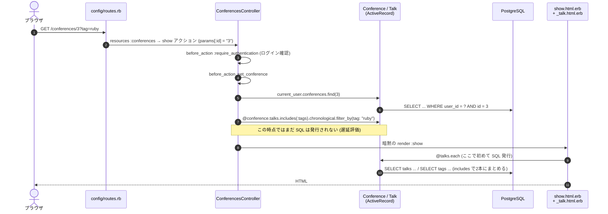

# このリポジトリで学ぶ Rails

Rails の主要な仕組みを、このリポジトリのどこで使っているかと対応づけて説明する。
Ruby の文法は [ruby-basics.md](ruby-basics.md) を先に読むとよい。

## 0. Rails の考え方: 「設定より規約」

Rails は **名前の付け方を揃えれば、つなぎ込みを自動でやってくれる**。最初はこれが「魔法」に見える。

| これを書くと | Rails が自動でつなぐもの |
| --- | --- |
| `class Talk < ApplicationRecord` | テーブル `talks` (複数形・小文字) |
| `belongs_to :conference` | カラム `conference_id`、クラス `Conference` |
| `resources :conferences` (routes.rb) | 7つの URL → `ConferencesController` の7アクション |
| `ConferencesController#show` | ビュー `app/views/conferences/show.html.erb` |
| `render @conferences` (ビュー) | パーシャル `app/views/conferences/_conference.html.erb` を1件ずつ |
| `t(".title")` (show.html.erb 内) | ja.yml の `ja.conferences.show.title` |
| `Talks::FavoritesController` | ファイル `app/controllers/talks/favorites_controller.rb` (`require` 不要) |

最後の行は **Zeitwerk** (自動読み込み) の規約。クラス名とファイルパスが一致していれば `require` を書かなくてよい。
逆に、名前がずれていると `NameError` になる。

## 1. 1リクエストの一生

「カンファレンス詳細を開く」(`GET /conferences/3?tag=ruby`) を追いかける。



読む順番:

1. [`config/routes.rb`](../../config/routes.rb) — どの URL がどのコントローラに行くか
2. [`app/controllers/conferences_controller.rb`](../../app/controllers/conferences_controller.rb) — 7アクションの典型
3. [`app/models/conference.rb`](../../app/models/conference.rb), [`talk.rb`](../../app/models/talk.rb) — 関連・検証・スコープ
4. [`app/views/conferences/show.html.erb`](../../app/views/conferences/show.html.erb), [`_talk.html.erb`](../../app/views/talks/_talk.html.erb)
5. [`spec/requests/conferences_spec.rb`](../../spec/requests/conferences_spec.rb) — 仕様をテストで確認

## 2. ルーティング (`config/routes.rb`)

```ruby
resources :conferences do                         # /conferences/... の7つ
  resource :export, only: :show, module: :conferences   # /conferences/:conference_id/export (単数形 resource は id なし)
  resources :talks, except: :index, shallow: true do    # 作成は /conferences/:id/talks、以降は /talks/:id
    resource :favorite, only: :update, module: :talks   # /talks/:talk_id/favorite
  end
end
```

`resources` が作る7アクション:

| HTTP | パス | アクション | 用途 |
| --- | --- | --- | --- |
| GET | /conferences | index | 一覧 |
| GET | /conferences/new | new | 作成フォーム |
| POST | /conferences | create | 作成 |
| GET | /conferences/:id | show | 詳細 |
| GET | /conferences/:id/edit | edit | 編集フォーム |
| PATCH/PUT | /conferences/:id | update | 更新 |
| DELETE | /conferences/:id | destroy | 削除 |

このリポジトリでは **7アクション以外を作らない** 方針。「お気に入りを切り替える」は
`TalksController#toggle_favorite` ではなく「お気に入りというリソースを更新する」と考えて `Talks::FavoritesController#update` にする。
コントローラが小さく保たれ、URL も予測しやすくなる。

## 3. コントローラ

```ruby
class ConferencesController < ApplicationController
  before_action :set_conference, only: %i[show edit update destroy]   # 共通の前処理

  def create
    @conference = current_user.conferences.build(conference_params)
    if @conference.save
      redirect_to @conference, notice: t(".success")          # 成功 → 302 で詳細へ
    else
      render :new, status: :unprocessable_content              # 失敗 → 422 でフォーム再表示
    end
  end

  private

  def conference_params
    params.expect(conference: %i[name venue starts_on ends_on website_url])   # 許可したキーだけ通す
  end
end
```

- **インスタンス変数 (`@conference`) はビューに渡る**。ローカル変数は渡らない
- **Strong Parameters** (`params.expect`): フォームから来た値のうち、許可したキーだけを通す。
  `user_id` などを勝手に送られても無視される (Mass Assignment 対策)。形が崩れていれば 400
- **成功時は redirect、失敗時は render** が定番 (PRG パターン)。失敗時に 422 を返すのは Turbo がそれを前提にしているため
- **`current_user.conferences.find`** と書くことで、他人のカンファレンスは `RecordNotFound` → 404 になる。
  `Conference.find(params[:id])` と書くと他人のデータが見えてしまう (認可漏れ)

## 4. モデル (ActiveRecord)

### 関連

```ruby
class Conference < ApplicationRecord
  belongs_to :user                             # conferences.user_id を持つ側
  has_many :talks, dependent: :destroy         # カンファレンス削除時にセッションも削除
end

class Talk < ApplicationRecord
  has_many :taggings, dependent: :destroy
  has_many :tags, through: :taggings           # 中間テーブル経由の多対多
end
```

### 検証 (validation)

```ruby
validates :title, presence: true, length: { maximum: 200 }   # 組み込みの検証
validate :ends_on_not_before_starts_on                       # 自作の検証メソッド
```

`save` は検証に失敗すると `false` を返し、`errors` に理由が入る。`save!` は例外を投げる。

### スコープとクエリ

```ruby
scope :chronological, -> { order(:starts_at, :id) }
scope :favorites, -> { where(favorite: true) }

Talk.favorites.chronological.limit(10)   # つなげられる
Talk.favorites.to_sql                    # 発行される SQL を確認できる
```

クエリは **遅延評価**。`where` や `order` をつなげた時点では SQL を発行せず、
`each` / `to_a` / `first` / `count` などで結果が必要になったときに初めて実行される。

### N+1 問題

一覧でセッションごとにタグを表示すると、素直に書くと「セッション一覧で1回 + セッションの数だけタグ取得」の SQL が発行される。

```ruby
@conference.talks.each { |talk| talk.tags.each { ... } }    # talks が 50件なら 51回 SQL
@conference.talks.includes(:tags).each { ... }               # 2回にまとまる
```

このリポジトリでは **Bullet** がテスト中に N+1 を検出すると例外にするので、書き忘れに気づける。
件数だけなら `counter_cache` (`conferences.talks_count`) で SQL 自体をなくしている。

`includes` + `joins(:tags).where(tags: ...)` の組み合わせには罠がある。Rails が1本の JOIN にまとめてしまい、
**絞り込んだタグ以外が表示されなくなる**。`Talk.tagged_with` がサブクエリを使っているのはそのため。

### コールバック

```ruby
before_save :assign_pending_tags    # 保存の直前に実行
```

便利だが、増やすと「保存したら何が起きるか」が追いにくくなる。このリポジトリでは最小限にしている。

### マイグレーション

DB のスキーマ変更は `db/migrate/` のファイルで管理する。直接 SQL で `ALTER TABLE` はしない。

```ruby
# db/migrate/20261104150100_create_talks.rb
create_table :talks do |t|
  t.references :conference, null: false, foreign_key: true   # conference_id + 外部キー制約 + インデックス
  t.string :title, null: false
  ...
end
add_check_constraint :talks, "rating IS NULL OR rating BETWEEN 1 AND 5", name: "talks_rating_range"
```

## 5. ビュー

```erb
<%# app/views/conferences/show.html.erb %>
<h1><%= @conference.name %></h1>              <%# 「イコール付き」は結果を出力する (自動で HTML エスケープ) %>
<% if @talks.any? %>                           <%# 「イコールなし」は実行のみで出力しない %>
  <%= render @talks %>                         <%# _talk.html.erb を1件ずつ描画 %>
<% end %>
<%= link_to t(".new_talk"), new_conference_talk_path(@conference), class: "btn-primary" %>
```

- `new_conference_talk_path` のような **パスヘルパー** は routes.rb から自動生成される (`bin/rails routes` で一覧)
- `<%= %>` は自動でエスケープされるので XSS に強い。`raw` / `html_safe` は使わない
- `t(".new_talk")` は **遅延参照**。ファイルの場所から `conferences.show.new_talk` を探す
- フォームは `form_with model: @conference`。新規なら POST、既存なら PATCH に自動で切り替わる

## 6. Hotwire (Turbo + Stimulus)

### Turbo Drive

リンクやフォームを自動で fetch に置き換え、`<body>` だけ差し替える。何も書かなくても SPA のような速さになる。

### Turbo Stream (部分更新)

お気に入りボタンを押すと、サーバは HTML の断片と「どこをどう変えるか」を返す。

```erb
<%# app/views/talks/favorites/update.turbo_stream.erb %>
<%= turbo_stream.replace dom_id(@talk, :favorite), partial: "talks/favorite_button", locals: { talk: @talk } %>
```

コントローラは `respond_to` で Turbo Stream と通常の HTML の両方に対応している (JS が無効でも動く)。

### Stimulus (少しの JS)

```html
<div data-controller="char-count">
  <textarea data-char-count-target="input" data-action="input->char-count#update"></textarea>
  <span data-char-count-target="output"></span>
</div>
```

`data-controller` の名前と `app/javascript/controllers/char_count_controller.js` が対応する (これも規約)。

## 7. 非同期処理 (Active Job + Solid Queue)

```ruby
PasswordsMailer.reset(user).deliver_later    # ジョブを DB に積んで、すぐ次へ進む
```

- web はジョブを `solid_queue_jobs` テーブルに INSERT するだけ
- worker (`bin/jobs`) がそれを取り出して実行する。失敗すれば `MailDeliveryJob` の設定に従って再試行
- 定期実行は `config/recurring.yml` (期限切れセッションの削除を毎日4時)

## 8. テスト (RSpec)

```ruby
RSpec.describe "Conferences" do                      # 何のテストか
  let(:user) { create(:user) }                       # 遅延評価される変数 (FactoryBot で作成)
  before { sign_in user }                            # 各テストの前処理

  context "他人のカンファレンス" do                    # 条件
    it "404 を返す" do                                 # 期待する振る舞い
      get conference_path(create(:conference))
      expect(response).to have_http_status(:not_found)
    end
  end
end
```

- `spec/factories/` がテストデータの雛形。`create(:talk, :attended)` のように trait で変化をつける
- `it { is_expected.to validate_presence_of(:title) }` は shoulda-matchers による1行の検証テスト

## 9. 次のステップ

- [exercises.md](exercises.md) の練習問題を解く
- Rails ガイド (日本語): https://railsguides.jp/ — 特に「Active Record の基礎」「Active Record の関連付け」「Rails のルーティング」
- 書籍の例: 『プロを目指す人のための Ruby 入門』(Ruby 文法)、『パーフェクト Ruby on Rails』(Rails 全般)
